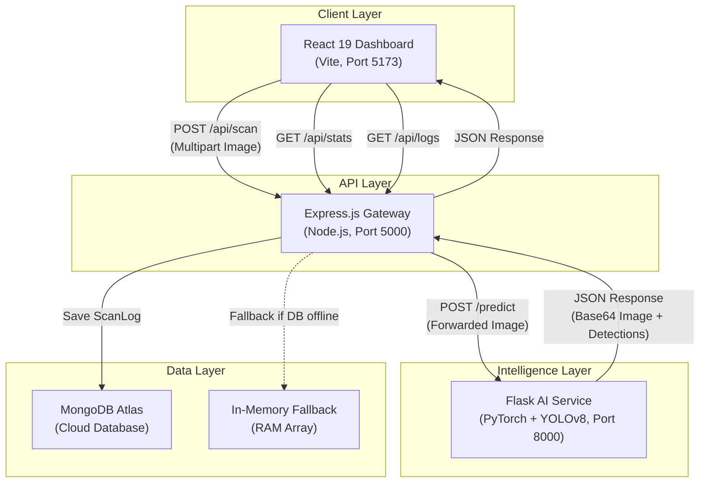

# PrecisionPCB — Automated PCB Defect Detection System

## Project Report

---

## Abstract

Printed Circuit Boards (PCBs) are a foundational component of modern electronics manufacturing. Identifying defects early in the production pipeline is critical to maintaining product quality and reducing material waste. Traditional manual visual inspection is slow, error-prone, and does not scale to high-throughput manufacturing environments.

This project presents **PrecisionPCB**, an end-to-end Automated Optical Inspection (AOI) system that leverages deep learning to detect six categories of PCB manufacturing defects in real time. The system is built on a **microservices architecture** comprising a React 19 dashboard, a Node.js/Express API gateway, a Python/Flask inference service powered by a custom-trained **YOLOv8** object detection model, and MongoDB Atlas for data persistence.

The trained model achieved a **mean Average Precision (mAP@0.50) of 90.86%** and a **mAP@0.50-95 of 55.10%** after 50 epochs of training on the PKU-Market-PCB dataset, with an inference latency of under 20 milliseconds on an NVIDIA RTX 4060 GPU.

---

## Table of Contents

1. [Introduction](#1-introduction)
2. [Problem Statement](#2-problem-statement)
3. [Objectives](#3-objectives)
4. [Literature Survey](#4-literature-survey)
5. [System Architecture](#5-system-architecture)
6. [Technology Stack](#6-technology-stack)
7. [Dataset Description](#7-dataset-description)
8. [Model Training & Evaluation](#8-model-training--evaluation)
9. [Implementation Details](#9-implementation-details)
10. [API Documentation](#10-api-documentation)
11. [Deployment Strategy](#11-deployment-strategy)
12. [Results & Discussion](#12-results--discussion)
13. [Future Scope](#13-future-scope)
14. [Conclusion](#14-conclusion)
15. [References](#15-references)

---

## 1. Introduction

Printed Circuit Boards (PCBs) serve as the backbone of virtually all electronic devices, from smartphones and laptops to medical instruments and automotive control systems. The PCB manufacturing process involves multiple stages—etching, drilling, plating, and soldering—each of which can introduce defects that compromise functionality, safety, and device longevity.

Automated Optical Inspection (AOI) systems have emerged as a critical quality assurance tool in the electronics industry. By leveraging computer vision and deep learning, these systems can identify defects faster and more reliably than human inspectors, enabling manufacturers to achieve higher yield rates and reduce costs associated with rework and recalls.

**PrecisionPCB** is a full-stack AOI system that integrates a state-of-the-art YOLOv8 object detection model into a production-ready web application. The system allows operators to upload PCB images through an intuitive dashboard, receive instant defect analysis with annotated images, and monitor production quality through real-time analytics and historical reporting.

---

## 2. Problem Statement

Manual inspection of PCBs presents several challenges:

1. **Human Error**: Inspectors experience fatigue, leading to inconsistent defect detection rates.
2. **Throughput Limitations**: Manual inspection creates bottlenecks in high-volume production lines.
3. **Subjectivity**: Defect classification may vary between inspectors, leading to unreliable quality metrics.
4. **Scalability**: Training new inspectors is time-consuming and expensive.

There is a need for an automated, scalable, and reliable system that can detect and classify PCB defects in real time with high accuracy, while providing actionable analytics to production managers.

---

## 3. Objectives

The primary objectives of this project are:

1. To train a custom YOLOv8 object detection model capable of identifying six categories of PCB manufacturing defects with high precision and recall.
2. To design and implement a microservices-based web application that allows users to upload PCB images, receive real-time defect analysis, and view historical quality metrics.
3. To achieve sub-second inference latency using GPU acceleration (CUDA) for real-time production environments.
4. To implement a robust, fault-tolerant system with offline fallback capabilities.
5. To containerize the entire application using Docker for reproducible, platform-independent deployment.

---

## 4. Literature Survey

### 4.1 Object Detection in Manufacturing

Object detection has evolved significantly from traditional image processing techniques (edge detection, template matching) to deep learning-based approaches. Convolutional Neural Networks (CNNs) have demonstrated superior performance in detecting small, irregularly shaped defects on complex backgrounds.

### 4.2 YOLO Family of Models

The YOLO (You Only Look Once) family of detectors introduced by Redmon et al. (2016) revolutionized real-time object detection by framing detection as a single regression problem. Unlike two-stage detectors (R-CNN, Faster R-CNN) that first propose regions and then classify them, YOLO processes the entire image in a single forward pass, making it significantly faster.

**YOLOv8** (Ultralytics, 2023) is the latest iteration, introducing:
- An anchor-free detection head that directly predicts object centers.
- Decoupled head architecture separating classification and regression tasks.
- Enhanced feature pyramid networks for multi-scale detection.
- Improved data augmentation strategies including mosaic and mixup.

### 4.3 PCB Defect Detection Datasets

The **PKU-Market-PCB** dataset (Peking University) is a benchmark dataset for PCB defect detection containing annotated images of six common defect types. The dataset provides YOLO-format annotations suitable for direct training.

### 4.4 Microservices Architecture

Martin Fowler (2014) defined microservices as an approach to developing a single application as a suite of small, independently deployable services. This architecture enables independent scaling, technology heterogeneity (using Python for ML and Node.js for API routing), and fault isolation.

---

## 5. System Architecture

The system follows a three-tier microservices architecture with a shared database layer:



### Data Flow Summary

| Step | Source | Destination | Data Transmitted |
|------|--------|-------------|------------------|
| 1 | User Browser | React Frontend | PCB image file via file input / drag-and-drop |
| 2 | React Frontend | Express Gateway | HTTP POST multipart form (`pcb_image` field) |
| 3 | Express Gateway | Flask AI Service | HTTP POST multipart form (`image` field) via Axios |
| 4 | Flask AI Service | Express Gateway | JSON: Base64 annotated image, bounding boxes, confidences, latencies |
| 5 | Express Gateway | MongoDB Atlas | Mongoose document: filename, timestamp, defects array, latency |
| 6 | Express Gateway | React Frontend | JSON: annotated image, defect list, image size, latencies |
| 7 | React Frontend | User Browser | Rendered annotated image with interactive SVG overlays |

---

## 6. Technology Stack

### 6.1 Frontend Technologies

| Technology | Version | Purpose |
|------------|---------|---------|
| React | 19.2.6 | Component-based UI framework |
| Vite | 8.0.12 | Build tool and dev server with Hot Module Replacement |
| Vanilla CSS | — | Neumorphic design system with custom CSS variables |
| SVG | — | Interactive bounding box overlays and responsive charts |
| ESLint | 10.3.0 | Code quality and linting |

### 6.2 Backend Technologies

| Technology | Version | Purpose |
|------------|---------|---------|
| Node.js | 20 (Alpine) | Server-side JavaScript runtime |
| Express.js | 5.2.1 | HTTP routing and middleware framework |
| Multer | 2.1.1 | Multipart file upload parsing (memory storage) |
| Axios | 1.17.0 | HTTP client for inter-service communication |
| Mongoose | 9.6.3 | MongoDB Object Document Mapper (ODM) |
| CORS | 2.8.6 | Cross-Origin Resource Sharing middleware |

### 6.3 AI/ML Technologies

| Technology | Version | Purpose |
|------------|---------|---------|
| Python | 3.10 | Programming language for ML pipeline |
| Flask | Latest | Lightweight web framework for inference API |
| PyTorch | Latest | Deep learning framework (CUDA-enabled) |
| Ultralytics | Latest | YOLOv8 model training and inference library |
| Pillow (PIL) | Latest | Image processing and format conversion |

### 6.4 Database & DevOps

| Technology | Purpose |
|------------|---------|
| MongoDB Atlas | Cloud-hosted NoSQL document database |
| Docker | Application containerization |
| Docker Compose | Multi-container orchestration |

---

## 7. Dataset Description

### 7.1 PKU-Market-PCB Dataset

The model was trained on the **PKU-Market-PCB (Data Enhanced Version)** dataset sourced from Peking University. The dataset is pre-split into training, validation, and test partitions with YOLO-format bounding box annotations.

### 7.2 Defect Classes

The dataset contains **6 classes** of PCB manufacturing defects:

| Class ID | Class Name | Description | Manufacturing Cause |
|----------|-----------|-------------|---------------------|
| 0 | `missing_hole` | Absent drill holes on pads | Drill bit misalignment or breakage |
| 1 | `mouse_bite` | Irregular, nibbled trace edges | Panel depanelization stress |
| 2 | `open_circuit` | Broken conductive trace paths | Over-etching or mechanical damage |
| 3 | `short` | Unintended copper bridges between traces | Under-etching or solder bridging |
| 4 | `spur` | Small protruding copper formations | Incomplete etching |
| 5 | `spurious_copper` | Residual copper deposits on substrate | Chemical bath contamination |

### 7.3 Dataset Configuration

The dataset configuration is defined in [pcb.yaml](file:///c:/Users/Roshan%20S%20Joe/OneDrive/Desktop/Project/pcb.yaml):

```yaml
path: "C:/Users/Roshan S Joe/OneDrive/Desktop/project/archive/PKU-Market-PCB(Data enhanced version)"
train: train/images
val: valid/images
test: test/images

nc: 6
names:
  0: missing_hole
  1: mouse_bite
  2: open_circuit
  3: short
  4: spur
  5: spurious_copper
```

---

## 8. Model Training & Evaluation

### 8.1 Base Model

The system uses **YOLOv8n (Nano)** as the base architecture. YOLOv8n is the smallest variant in the YOLOv8 family, optimized for real-time inference on edge and embedded devices. Transfer learning was employed by initializing from pre-trained COCO weights (`yolov8n.pt`).

### 8.2 Training Configuration

Training was executed over **4 iterative runs** (train, train-2, train-3, train-4), with the final run (`train-4`) producing the deployed model. The complete training hyperparameters are documented in [args.yaml](file:///c:/Users/Roshan%20S%20Joe/OneDrive/Desktop/Project/runs/detect/train-4/args.yaml).

| Parameter | Value | Rationale |
|-----------|-------|-----------|
| Epochs | 50 | Sufficient convergence without overfitting |
| Image Size | 640×640 | Standard YOLO input resolution |
| Batch Size | 16 | Optimized for 8GB laptop VRAM (RTX 4060) |
| Device | GPU 0 (CUDA) | NVIDIA RTX 4060 for hardware acceleration |
| Workers | 0 | Prevents Windows multiprocessing crashes |
| Optimizer | Auto (SGD) | Automatic optimizer selection by Ultralytics |
| Initial Learning Rate | 0.01 | Standard SGD learning rate |
| Final Learning Rate | 0.01 | Cosine annealing target |
| Momentum | 0.937 | SGD momentum coefficient |
| Weight Decay | 0.0005 | L2 regularization to prevent overfitting |
| Warmup Epochs | 3.0 | Gradual learning rate ramp-up |
| IoU Threshold | 0.7 | Intersection-over-Union for NMS |
| Confidence Threshold | 0.15 | Minimum detection confidence (inference) |
| AMP (Mixed Precision) | Enabled | Reduces VRAM usage and speeds up training |
| Mosaic Augmentation | 1.0 | Combines 4 training images into one |
| Horizontal Flip | 0.5 | 50% probability of horizontal flipping |

### 8.3 Data Augmentation

The following augmentation strategies were applied during training to improve model generalization:

| Augmentation | Value | Effect |
|-------------|-------|--------|
| HSV Hue Shift | 0.015 | Simulates color variation in PCB substrates |
| HSV Saturation | 0.7 | Varies color intensity |
| HSV Value | 0.4 | Adjusts brightness |
| Translation | 0.1 | Random 10% spatial shifts |
| Scale | 0.5 | Random zoom between 50%–150% |
| Horizontal Flip | 0.5 | Mirror augmentation |
| Mosaic | 1.0 | Combines 4 images into a grid |
| Erasing | 0.4 | Random rectangular region erasure |

### 8.4 Training Results

The final model (`train-4`, epoch 50) achieved the following metrics on the validation set:

| Metric | Value |
|--------|-------|
| **Precision** | **96.23%** |
| **Recall** | **85.27%** |
| **mAP@0.50** | **90.86%** |
| **mAP@0.50-95** | **55.10%** |
| Validation Box Loss | 1.333 |
| Validation Classification Loss | 0.693 |
| Validation DFL Loss | 0.863 |

### 8.5 Training Convergence

The training progressed over 50 epochs with the following convergence behavior (selected milestones from [results.csv](file:///c:/Users/Roshan%20S%20Joe/OneDrive/Desktop/Project/runs/detect/train-4/results.csv)):

| Epoch | Train Box Loss | Train Cls Loss | Precision | Recall | mAP@50 | mAP@50-95 |
|-------|---------------|----------------|-----------|--------|--------|-----------|
| 1 | 3.082 | 5.204 | 28.22% | 15.35% | 14.99% | 6.00% |
| 5 | 1.993 | 1.594 | 78.32% | 61.37% | 68.22% | 31.26% |
| 10 | 1.823 | 1.194 | 86.91% | 72.12% | 77.49% | 37.88% |
| 20 | 1.652 | 0.948 | 91.92% | 77.01% | 84.34% | 42.19% |
| 30 | 1.499 | 0.823 | 94.41% | 82.02% | 87.71% | 48.48% |
| 40 | 1.406 | 0.750 | 95.31% | 85.34% | 90.38% | 53.27% |
| 50 | 1.203 | 0.611 | 96.23% | 85.27% | 90.86% | 55.10% |

> [!NOTE]
> The model shows strong convergence with steadily decreasing losses and increasing precision/recall throughout training. The gap between mAP@50 (90.86%) and mAP@50-95 (55.10%) indicates the model performs well at standard IoU thresholds but has room for improvement at stricter overlap requirements.

### 8.6 Training Artifacts

The training process generated the following diagnostic outputs stored in [runs/detect/train-4/](file:///c:/Users/Roshan%20S%20Joe/OneDrive/Desktop/Project/runs/detect/train-4):

| File | Description |
|------|-------------|
| `confusion_matrix.png` | Confusion matrix showing per-class prediction accuracy |
| `confusion_matrix_normalized.png` | Row-normalized confusion matrix |
| `BoxF1_curve.png` | F1 score vs. confidence threshold curve |
| `BoxPR_curve.png` | Precision-Recall curve |
| `BoxP_curve.png` | Precision vs. confidence threshold |
| `BoxR_curve.png` | Recall vs. confidence threshold |
| `results.png` | Combined training metrics plots |
| `labels.jpg` | Dataset label distribution visualization |

---

## 9. Implementation Details

### 9.1 AI Inference Service

**File**: [ai_service.py](file:///c:/Users/Roshan%20S%20Joe/OneDrive/Desktop/Project/ai_service.py)

The inference service is a Flask application that:

1. **Auto-detects hardware**: Checks CUDA availability and selects GPU or CPU.
2. **Loads model at startup**: The YOLOv8 weights are loaded once into memory during server initialization.
3. **Processes images**: Receives image uploads, converts them to RGB using PIL, and feeds them to the model.
4. **Returns structured results**: Extracts bounding box coordinates, class IDs, class names, confidence scores, and latency metrics. Renders an annotated image and encodes it as Base64 for JSON transmission.

```python
# Core inference call
results = model.predict(source=img, conf=0.15, line_width=2, device=device)

# Extract detections
for box in results[0].boxes.cpu():
    cls_id = int(box.cls[0].item())
    conf = float(box.conf[0].item())
    xyxy = box.xyxy[0].tolist()
```

### 9.2 API Gateway

**File**: [node_backend/server.js](file:///c:/Users/Roshan%20S%20Joe/OneDrive/Desktop/Project/node_backend/server.js)

The Express.js gateway serves as the central coordinator:

1. **File Upload Handling**: Uses Multer with in-memory storage to buffer uploaded images in RAM.
2. **Service Orchestration**: Forwards image data to the Flask service via Axios.
3. **Data Persistence**: Saves scan logs to MongoDB Atlas using Mongoose ODM with automatic fallback to an in-memory array.
4. **Aggregation Pipeline**: Computes yield rates, average latencies, and defect distributions using MongoDB's aggregation framework.

```javascript
// MongoDB Aggregation for defect distribution
const categoryAggregation = await ScanLog.aggregate([
    { $unwind: "$defects" },
    { $group: { _id: "$defects.className", count: { $sum: 1 } } }
]);
```

### 9.3 Database Schema

**Collection**: `scanlogs`

```javascript
const ScanLogSchema = new mongoose.Schema({
    timestamp:       { type: Date, default: Date.now },
    filename:        String,
    defectsDetected: Number,
    defects: [{
        classId:    Number,
        className:  String,
        confidence: Number,
        box:        [Number]   // [x1, y1, x2, y2]
    }],
    inferenceTimeMs: Number
});
```

### 9.4 Frontend Dashboard

**File**: [pcb_frontend/src/App.jsx](file:///c:/Users/Roshan%20S%20Joe/OneDrive/Desktop/Project/pcb_frontend/src/App.jsx)

The React dashboard provides three primary views:

1. **Inspection Tab**: Upload zone with drag-and-drop, image viewport with interactive SVG bounding box overlays, detection results panel, and a real-time diagnostic console.
2. **Analytics Tab**: KPI metric cards (total scans, defective boards, yield rate, average latency) and custom SVG-based responsive bar and area charts.
3. **History Tab**: Expandable table of past scan records with per-record deletion and bulk clear functionality.

**Key Frontend Features**:
- **Interactive SVG Overlays**: Bounding boxes are rendered as clickable SVG `<rect>` elements mapped to the image's natural resolution, enabling click-to-select defect highlighting.
- **Offline Resilience**: The frontend detects backend availability and falls back to `localStorage` for data persistence and client-side statistics computation.
- **Zero External Dependencies**: Icons and charts are implemented using inline SVGs and mathematical calculations, avoiding third-party UI libraries.

### 9.5 Neumorphic Design System

**File**: [pcb_frontend/src/index.css](file:///c:/Users/Roshan%20S%20Joe/OneDrive/Desktop/Project/pcb_frontend/src/index.css)

The UI employs a **Neumorphic (Soft UI)** design language using paired drop shadows to simulate depth:

```css
/* Raised element: appears to protrude from the surface */
--shadow-extruded: 9px 9px 16px rgb(163,177,198,0.6),
                  -9px -9px 16px rgba(255,255,255,0.5);

/* Recessed element: appears pressed into the surface */
--shadow-inset: inset 6px 6px 10px rgb(163,177,198,0.6),
               inset -6px -6px 10px rgba(255,255,255,0.5);
```

Typography uses three tiers:
- **Display**: Plus Jakarta Sans (headings)
- **Body**: DM Sans (paragraphs, labels)
- **Monospace**: JetBrains Mono (code, metrics, console)

---

## 10. API Documentation

### 10.1 Scan Endpoint

```
POST /api/scan
```

**Description**: Upload a PCB image for automated defect inspection.

**Request**: Multipart form data with field `pcb_image` (image file).

**Response** (200 OK):
```json
{
  "success": true,
  "logId": "668a1b2c3d4e5f6a7b8c9d0e",
  "annotatedImage": "<base64-encoded JPEG string>",
  "defectCount": 2,
  "defects": [
    {
      "class_id": 2,
      "class_name": "open_circuit",
      "confidence": 0.9412,
      "box": [120.4, 245.1, 150.2, 280.5]
    }
  ],
  "imageSize": { "width": 640, "height": 640 },
  "latencies": {
    "preprocess_ms": 1.2,
    "inference_ms": 12.7,
    "postprocess_ms": 1.1,
    "total_ms": 55.4
  }
}
```

### 10.2 Statistics Endpoint

```
GET /api/stats
```

**Response** (200 OK):
```json
{
  "success": true,
  "stats": {
    "totalScans": 47,
    "cleanScans": 12,
    "defectiveScans": 35,
    "yieldRate": 25.53,
    "avgLatencyMs": 58.21,
    "defectDistribution": {
      "missing_hole": 5,
      "mouse_bite": 8,
      "open_circuit": 12,
      "short": 6,
      "spur": 3,
      "spurious_copper": 4
    }
  }
}
```

### 10.3 History Endpoints

| Method | Endpoint | Description |
|--------|----------|-------------|
| `GET` | `/api/logs` | Retrieve the 30 most recent scan records |
| `DELETE` | `/api/logs/:id` | Delete a specific scan record by ID |
| `DELETE` | `/api/logs` | Clear all scan history |

### 10.4 Health Check

```
GET /health (Port 8000 — AI Service)
```

Returns model status, device info, and model path.

---

## 11. Deployment Strategy

### 11.1 Local Development

The system is designed for local development with three terminal sessions:

```
Terminal 1 (AI Service):   python ai_service.py          → Port 8000
Terminal 2 (API Gateway):  node server.js                → Port 5000
Terminal 3 (Frontend):     npm run dev                   → Port 5173
```

### 11.2 Docker Containerization

Each service has its own Dockerfile:

| Service | Dockerfile | Base Image | Size |
|---------|-----------|------------|------|
| AI Service | [Dockerfile.ai](file:///c:/Users/Roshan%20S%20Joe/OneDrive/Desktop/Project/Dockerfile.ai) | `python:3.10-slim` | ~1.5 GB |
| API Gateway | [node_backend/Dockerfile](file:///c:/Users/Roshan%20S%20Joe/OneDrive/Desktop/Project/node_backend/Dockerfile) | `node:20-alpine` | ~150 MB |
| Frontend | [pcb_frontend/Dockerfile](file:///c:/Users/Roshan%20S%20Joe/OneDrive/Desktop/Project/pcb_frontend/Dockerfile) | `node:20-alpine` | ~300 MB |

### 11.3 Docker Compose Orchestration

The [docker-compose.yml](file:///c:/Users/Roshan%20S%20Joe/OneDrive/Desktop/Project/docker-compose.yml) file orchestrates all three services:

```yaml
services:
  ai_service:     # Port 8000
  backend:        # Port 5000, depends_on: ai_service
  frontend:       # Port 5173, depends_on: backend
```

**Key Features**:
- Service dependency ordering ensures correct startup sequence.
- Volume mounts enable live code reloading during development.
- `restart: unless-stopped` policy ensures automatic recovery after crashes.

One-command deployment:
```bash
docker compose up --build
```

---

## 12. Results & Discussion

### 12.1 Model Performance

The final YOLOv8n model demonstrates strong detection capability:

- **96.23% Precision**: The model very rarely produces false positives.
- **85.27% Recall**: The model detects the vast majority of actual defects.
- **90.86% mAP@50**: Excellent overall detection accuracy at standard IoU threshold.

### 12.2 System Performance

| Metric | Value |
|--------|-------|
| Average Inference Time (GPU) | < 20 ms |
| Average Total Round-Trip Time | < 60 ms |
| Concurrent Service Availability | 3 independent microservices |
| Offline Capability | Full (localStorage + in-memory DB fallback) |

### 12.3 Fault Tolerance

The system implements a **multi-layer graceful degradation** strategy:

1. **Database Layer**: If MongoDB Atlas is unreachable, the Express gateway automatically stores logs in an in-memory JavaScript array, ensuring zero data loss during the session.
2. **Service Layer**: If the Flask AI service is offline, the Express gateway returns a descriptive error message instead of crashing.
3. **Client Layer**: If the Express gateway is offline, the React frontend detects the outage within 3 seconds (via AbortController timeout), switches to local mode, and uses browser `localStorage` for persistence and client-side JavaScript for analytics computation.
4. **Reconnection**: The frontend polls the backend every 30 seconds and automatically restores online functionality when the connection is re-established.

---

## 13. Future Scope

1. **Model Improvement**: Training with larger YOLOv8 variants (YOLOv8s, YOLOv8m) and expanded datasets for higher mAP@50-95 scores.
2. **Real-Time Video Feed**: Integrating live camera streams for continuous conveyor-belt inspection.
3. **Edge Deployment**: Exporting the model to ONNX or TensorRT format for deployment on embedded devices (NVIDIA Jetson).
4. **User Authentication**: Adding role-based access control for production environments.
5. **Alerting System**: Integrating email/SMS notifications when defect rates exceed configurable thresholds.
6. **Multi-Board Batch Processing**: Supporting simultaneous inspection of multiple PCB images.

---

## 14. Conclusion

PrecisionPCB successfully demonstrates the application of deep learning-based object detection in automated PCB quality inspection. The system achieves a mAP@50 of **90.86%** with sub-20ms GPU inference latency, making it suitable for real-time industrial deployment.

The microservices architecture ensures modularity, independent scalability, and fault tolerance. The multi-layer offline fallback mechanism guarantees system availability even in disconnected environments. The Neumorphic dashboard provides an intuitive, modern interface for operators to inspect boards, analyze defect trends, and manage inspection history.

The project integrates technologies spanning machine learning (PyTorch, YOLOv8), backend engineering (Node.js, Express, Flask, MongoDB), frontend development (React, SVG, CSS), and DevOps (Docker, Docker Compose) into a cohesive, production-grade application.

---

## 15. References

1. Redmon, J., Divvala, S., Girshick, R., & Farhadi, A. (2016). *You Only Look Once: Unified, Real-Time Object Detection*. CVPR 2016.
2. Ultralytics. (2023). *YOLOv8 Documentation*. https://docs.ultralytics.com
3. PKU-Market-PCB Dataset. Peking University. Available on Kaggle.
4. MongoDB Atlas Documentation. https://www.mongodb.com/docs/atlas/
5. React 19 Documentation. https://react.dev
6. Express.js Documentation. https://expressjs.com
7. Flask Documentation. https://flask.palletsprojects.com
8. Docker Documentation. https://docs.docker.com
9. Fowler, M. (2014). *Microservices: A definition of this new architectural term*. https://martinfowler.com/articles/microservices.html
10. PyTorch Documentation. https://pytorch.org/docs/stable/

---

> **Project By**: Roshan S Joe
